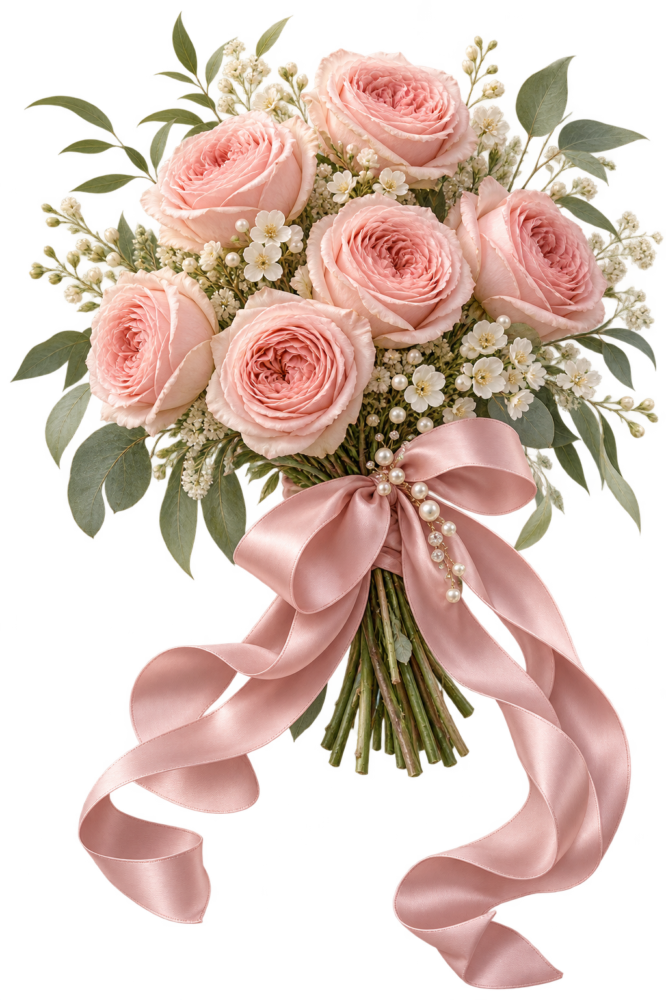
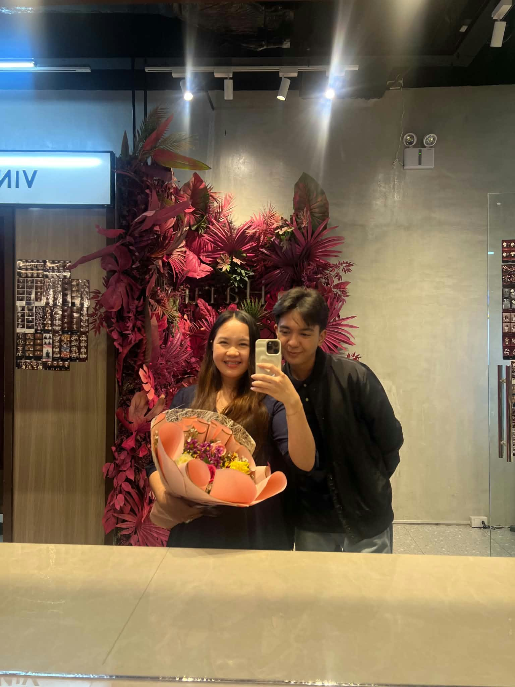
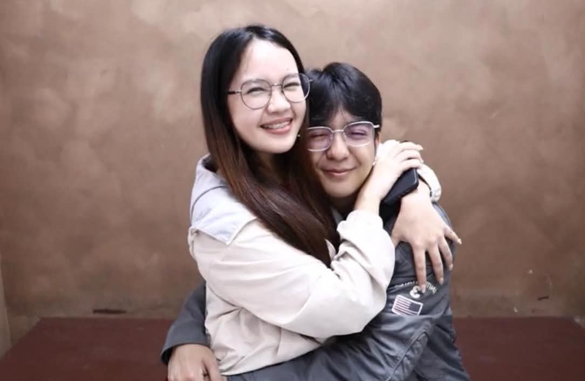
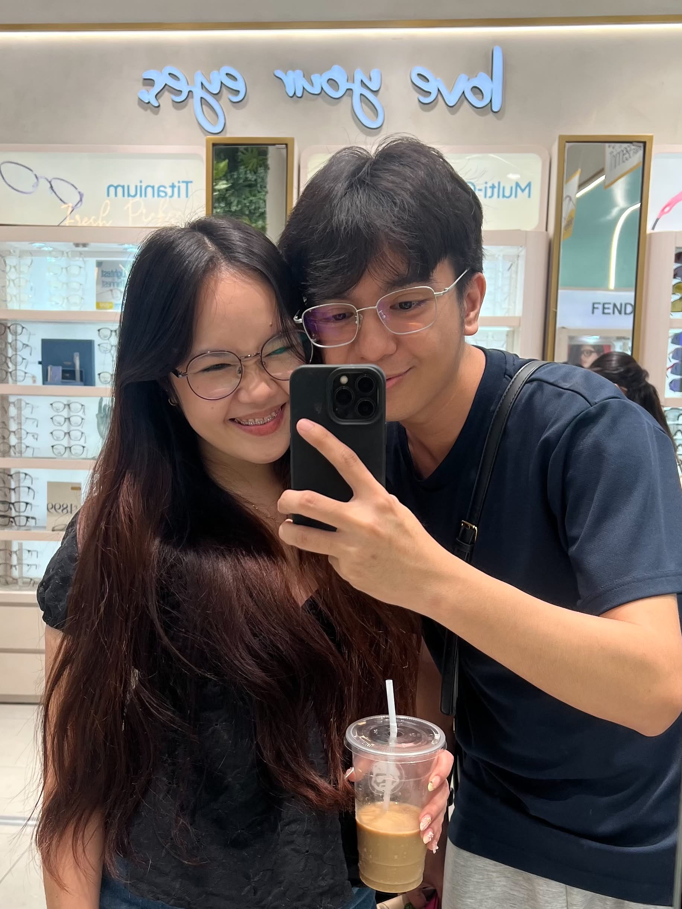
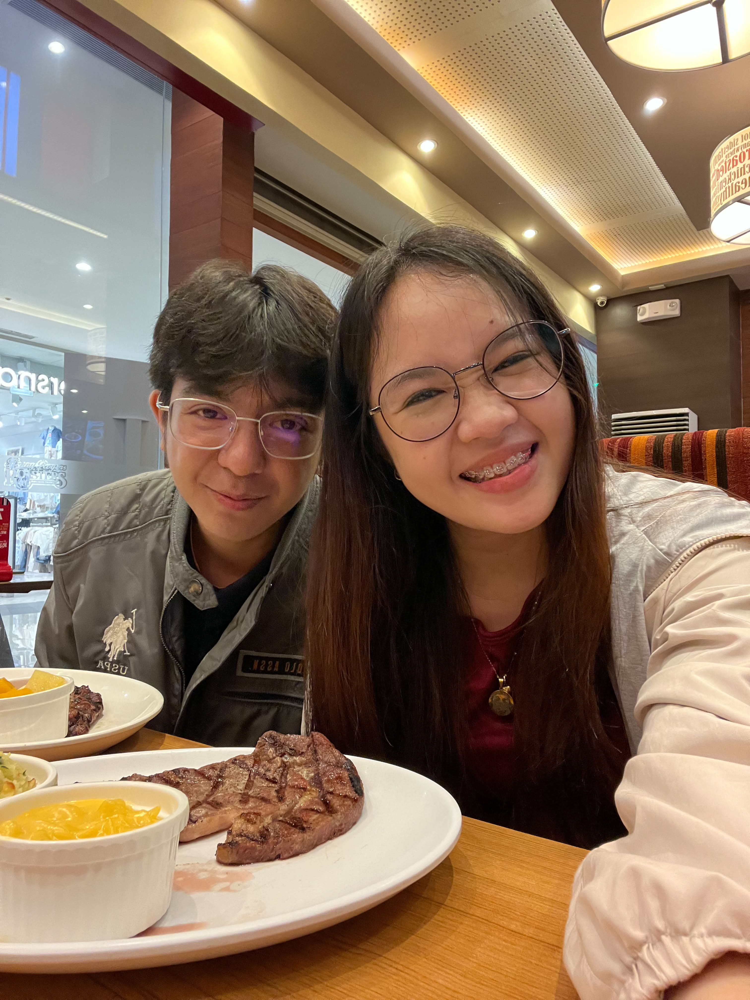

# Love for Julie — Complete Project Code

All six files in order, complete and runnable. The ZIP includes the local rose artwork. Add your own five JPG photographs and MP3 as explained at the end.

## 1. `index.html`

```html
<!DOCTYPE html>
<html lang="en">
<head>
  <meta charset="UTF-8">
  <meta name="viewport" content="width=device-width, initial-scale=1">
  <meta name="theme-color" content="#fff5f7">
  <meta name="description" content="A little world made with all my love for Baby Julie, by James Traigo.">
  <title>For My Baby Julie · With love, James</title>
  <link rel="stylesheet" href="css/style.css">
  <script src="js/script.js" defer></script>
</head>
<body>
  <a class="skip-link" href="#main">Skip to the love letter</a>
  <header class="site-header">
    <a class="monogram" href="index.html" aria-label="James and Julie, home">J <span>♡</span> J</a>
    <nav aria-label="Main navigation">
      <a href="#letter">The letter</a><a href="#surprises">Little secrets</a><a href="memories.html">Our memories ↗</a>
    </nav>
    <button class="icon-button" data-theme aria-label="Switch to dreamy night mode" title="A little moonlight">☾</button>
  </header>

  <main id="main">
    <section class="hero" id="beginning" aria-labelledby="hero-title">
      <div class="hero-copy">
        <p class="eyebrow">A love letter, a little magic, and you</p>
        <h1 id="hero-title">For My<br><span>Baby Julie</span></h1>
        <p class="hero-subtitle">A little world made with all my love,<br>just for you.</p>
        <div class="hero-actions">
          <button class="button primary pulse" id="open-heart">Open My Heart 💌</button>
          <button class="text-button" data-play>Play Our Song 🎶</button>
        </div>
        <p class="signature">Forever with love, James Traigo.</p>
        <a class="scroll-cue" href="#letter"><span>↓</span> A little more love, just below</a>
      </div>
      <div class="hero-art">
        <div class="art-halo"></div>
        
        <span class="art-note">a bouquet that never fades</span>
        <button class="charm charm-one" data-charm="heart" aria-label="Discover the little heart charm" title="A tiny secret">♡</button>
        <button class="charm charm-two" data-charm="star" aria-label="Discover the little star charm" title="Follow the sparkle">✧</button>
      </div>
    </section>

    <div class="ribbon-line"><span>YOU ARE MY FAVORITE LITTLE PART OF EVERY DAY</span><span aria-hidden="true">♡</span><span>ALWAYS SOMETHING TO BE THANKFUL FOR</span></div>

    <section class="letter-section section" id="letter" aria-labelledby="letter-title">
      <div class="section-heading reveal">
        <p class="eyebrow">01 / Words from my heart</p>
        <h2 id="letter-title">Some feelings deserve<br><em>a whole love letter.</em></h2>
        <p>Take your time, my love. Every word is for you.</p>
      </div>
      <div class="envelope" id="envelope" aria-hidden="true"><div class="envelope-note">My sweetest Julie ♡</div><div class="envelope-front"></div><div class="envelope-flap"></div><span class="wax-seal">♡</span></div>
      <article class="letter-paper" id="love-letter" tabindex="-1" aria-label="A love letter from James to Julie">
        <div class="letter-topline"><span>A LETTER FOR MY FAVORITE PERSON</span><span aria-hidden="true">♡</span></div>
        <h3>My Baby Julie,</h3>
        <!-- Edit these paragraphs to make the letter even more personal. -->
        <div class="letter-words">
          <p>I wanted to make you something you could come back to whenever you need a little warmth. Something that quietly says, “You are thought of. You are appreciated. You are loved.” So here is this little world, made for you, with all the feelings I sometimes find hard to fit into one message. You do not have to read it quickly. Imagine me sitting beside you, smiling a little, and telling you every word.</p>
          <p>I miss you in the middle of ordinary days. Sometimes nothing special is happening, and I still catch myself wishing you were there. I wish I could tell you a small thing that made me laugh, hear how your day is going, or simply enjoy a quiet moment with you. Missing you is not only about wanting a big adventure together. Often, it is just wanting your company while life carries on.</p>
          <p>The smallest moments with you mean so much to me. A little conversation, a kind reply, a laugh that arrives when I need it, or a moment when you make time for me can stay in my mind long after the day ends. Those things might seem simple to you, but they become memories I keep close. You remind me that happiness does not always need a big occasion. Sometimes it is a familiar voice and the feeling of being understood.</p>
          <p>Your smile makes my days brighter, my love. But it is more than your smile that draws me to you. It is your kindness, your sweetness, and the way your presence makes an ordinary moment feel softer. I appreciate the person behind the smile, too: the one who has her own thoughts, worries, dreams, and tired days. You do not need to be cheerful all the time to matter to me.</p>
          <p>Thank you for the time you share with me. I know that time, attention, and care are real gifts. Thank you for checking in, for listening, for making an effort, and for the happiness you bring into my life. I notice the little things, even when you think they are nothing special. The thought behind them reaches me. I hope the way I treat you helps you feel that your care is seen and valued.</p>
          <p>I want you to feel appreciated and respected with me. Your feelings deserve room. Your boundaries deserve respect. Your voice deserves to be heard, even when we see things differently. I want to listen without rushing to answer and ask questions instead of assuming I already understand. You should be able to tell me what you need, take your own time, and be yourself without feeling that you must earn my kindness.</p>
          <p>There is still so much I want to learn about you, my favorite person. I want to know what brings you peace, what you hope for, what makes you laugh, and what helps when a day feels heavy. I want to keep noticing the ways you change and grow. Caring about you means staying curious about who you are, not holding you to an idea I made in my head.</p>
          <p>I hope I can support your dreams in useful ways. I want to celebrate the achievements you worked hard for, including the quiet ones that other people may not see. If you need encouragement, I want to offer it. If you need someone to listen, I want to make room. And if you need space to focus, rest, or find your own direction, I want to respect that, too. Your life and your dreams matter to me.</p>
          <p>On difficult days, you do not have to find beautiful words for what you feel. You can tell me that you are tired, confused, or simply having a hard time. I cannot solve everything, but I can try to be patient and present. I would like to pray with you when you want to, sit with you in the uncertainty, and remind you gently that a difficult day does not make you any less worthy of care.</p>
          <p>I do not need every day between us to be perfect. I know that people get tired, misunderstand things, and sometimes struggle to explain themselves. What matters to me is our willingness to be honest, to listen, to apologize when we are wrong, and to make things better through real effort. I want the good moments to feel joyful and the hard conversations to feel respectful.</p>
          <p>When I think about the future, I feel hopeful. I would be happy to become your boyfriend if that is a step we both want when the time feels right. And someday, if we keep growing together and freely choosing the same path, I would love the chance to be your husband. That hope is an invitation, never a demand. I want a future we both feel peaceful and happy choosing, one honest step at a time.</p>
          <p>I want my love to show in the way I live, not only in a lovely letter. I want it to look like patience when things take time, honesty when a conversation is uncomfortable, loyalty in everyday choices, and effort that continues after a sweet moment has passed. I know that trust grows through what we repeatedly do. I want to keep learning how to care for you well, and to take responsibility when I fall short.</p>
          <p>I thank God that our paths crossed. You are my sweetest blessing, and knowing you has given me so many reasons to be grateful. I pray that He gives us wisdom, guides our choices, protects us, and teaches us to treat each other with kindness. I pray for your peace, your health, your dreams, and the people you love. May whatever grows between us be rooted in respect, faith, and sincere care.</p>
          <p>Baby Julie, I hope this little gift makes you smile. When you look at these roses, open a secret, or add a memory to these pages, remember that someone took time to think of you with a full heart. Thank you for being you. Thank you for the moments we have shared and the chance to know you more. For today, I simply want you to feel loved, gently and honestly, right where you are.</p>
        </div>
        <p class="letter-signoff">With all the love in my heart,<br><span>Your James Traigo 💗</span></p>
        <button class="text-button" id="replay-letter">Read Every Word Again 💕</button>
      </article>
    </section>

    <section class="special-section section" aria-labelledby="special-title">
      <div class="section-heading reveal"><p class="eyebrow">02 / It's the little things</p><h2 id="special-title">Why you are<br><em>special to me.</em></h2></div>
      <div class="special-grid">
        <article class="reveal"><span class="number">01</span><h3>Your smile</h3><p>That little bit of sunshine you bring into an ordinary day. Thinking of it still makes me smile, too.</p></article>
        <article class="reveal"><span class="number">02</span><h3>Your kind heart</h3><p>The care you give, the little things you notice, and the thought behind the things you do. I see them.</p></article>
        <article class="reveal"><span class="number">03</span><h3>Simply, you</h3><p>Your dreams, your stories, your wonderfully real self. You never have to be perfect to be special to me.</p></article>
      </div>
      <blockquote class="reveal">“My favorite place is a little moment<br>shared with you.”<cite>— With love, James</cite></blockquote>
    </section>

    <section class="section surprises-section" id="surprises" aria-labelledby="surprises-title">
      <div class="section-heading reveal"><p class="eyebrow">03 / Little things, big feelings</p><h2 id="surprises-title">A few secrets,<br><em>just between us.</em></h2><p>Follow your heart. There is a little love behind every one.</p></div>
      <div class="secret-grid">
        <button class="secret-card reveal" data-secret="kiss"><span>💋</span><strong>A Secret Kiss</strong><small>A tiny kiss, sent your way ↗</small></button>
        <button class="secret-card reveal" data-secret="hug"><span>♡ ♡</span><strong>A Hug From James</strong><small>For whenever you need one ↗</small></button>
        <button class="secret-card reveal" data-secret="prayer"><span>✧</span><strong>A Little Prayer</strong><small>You are in my prayers, too ↗</small></button>
        <button class="secret-card reveal" data-secret="reasons"><span>♡</span><strong>Reasons I Love You</strong><small>One little reason at a time ↗</small></button>
        <button class="secret-card reveal" data-secret="hiddenLetter"><span>💌</span><strong>A Letter Just for You</strong><small>A few more things from my heart ↗</small></button>
        <button class="secret-card reveal" data-secret="thousand"><span>💞</span><strong>A Thousand Hearts</strong><small>A whole sky full of affection ↗</small></button>
      </div>
      <div class="together-bar reveal">
        <div><p class="eyebrow">A little love goes a long way</p><button class="text-button" data-secret="littleLove">Send Julie a Little Love 💗</button></div>
        <button class="heart-counter" id="heart-counter" aria-label="Send a heart"><span aria-hidden="true">♡</span><span id="heart-count">0</span><small>little hearts for you</small></button>
        <button class="button secondary" data-secret="wish">Make a Wish Together ✨</button>
      </div>
      <p id="heart-status" class="sr-only" role="status"></p>
    </section>

    <section class="garden-section section" aria-labelledby="garden-title">
      <div class="section-heading reveal"><p class="eyebrow">04 / A garden of little wishes</p><h2 id="garden-title">Love grows in<br><em>the little moments.</em></h2><p>One of these roses has something to tell you.</p></div>
      <div class="garden">
        <div class="garden-flower" aria-hidden="true"></div>
        <button class="garden-flower secret-rose" data-secret="rose" aria-label="Tap the Secret Rose"><span>Tap the Secret Rose 🌹</span></button>
        <div class="garden-flower" aria-hidden="true"></div>
      </div>
      <div class="final-secret-wrap">
        <button class="charm" data-charm="bow" aria-label="Discover the little ribbon charm">🎀</button>
        <p id="charm-status" role="status">Find the heart, star, and ribbon charms. A final letter is waiting. 0 / 3</p>
        <button class="button secondary" id="final-secret" data-secret="final" hidden>One Last Secret 🎀</button>
      </div>
    </section>

    <section class="memory-invite section reveal">
      <p class="eyebrow">05 / Our little collection</p><h2>Five moments.<br><em>A heart full of memories.</em></h2><p>A place for the smiles, the ordinary days,<br>and the moments we never want to forget.</p><a class="button primary" href="memories.html">Open Our Memories ↗</a>
    </section>
  </main>
  <footer><span class="footer-heart reveal" aria-hidden="true">♡</span><p>Made with love by James Traigo.</p><small>For my Baby Julie. Always with a grateful heart.</small><a class="text-button" href="#beginning">Back to the Beginning ↑</a></footer>
  <noscript><p class="noscript">The letter and navigation work without JavaScript. Enable JavaScript for the music player, secrets, and animations.</p></noscript>
</body>
</html>
```

## 2. `css/style.css`

```css
@import url('https://fonts.googleapis.com/css2?family=Great+Vibes&family=Nunito:wght@400;500;600;700;800&display=swap');
/* Shared by both pages. All illustrations are local; only these fonts need internet. */ :root {
  --bg:#fff7f7;
  --paper:#fffdfb;
  --ink:#512937;
  --muted:#805563;
  --rose:#a3375b;
  --rose-light:#f4cbd6;
  --line:#e9cbd3;
  --glass:#fffaf5de;
  --shadow:0 18px 70px #7e3b5010;
  --script:'Great Vibes','Brush Script MT',cursive;
  --body:'Nunito',system-ui,sans-serif
}
 :root[data-theme="night"] {
  --bg:#281a29;
  --paper:#382232;
  --ink:#ffeaf1;
  --muted:#ddb7c9;
  --rose:#ffb4cf;
  --rose-light:#714155;
  --line:#684456;
  --glass:#382232ef;
  --shadow:0 18px 70px #07030940
}
 * {
  box-sizing:border-box
}
html {
  scroll-behavior:smooth;
  scroll-padding-top:100px
}
body {
  margin:0;
  color:var(--ink);
  background:var(--bg);
  font:16px/1.75 var(--body);
  transition:background .7s,color .7s;
  overflow-x:clip
}
body::before {
  content:"";
  position:fixed;
  inset:0;
  pointer-events:none;
  z-index:-1;
  background:radial-gradient(ellipse at 90% 15%,#f6c3d334,transparent 52%),radial-gradient(ellipse at 4% 65%,#eecdd440,transparent 40%)
}
body[data-page="memories"] {
  min-height:100vh
}
img {
  max-width:100%;
  display:block
}
button,a,input {
  -webkit-tap-highlight-color:transparent
}
button,input {
  font:inherit
}
button {
  cursor:pointer
}
a {
  color:inherit;
  text-decoration:none
}
button {
  color:inherit
}
h1,h2,h3,p {
  margin-top:0
}
h1,h2,h3 {
  font-weight:500
}
h2 {
  font:clamp(32px,4vw,52px)/1.25 Georgia,serif;
  letter-spacing:-1px
}
h2 em {
  color:var(--rose);
  font:1.34em/1.12 var(--script);
  letter-spacing:0
}
button,a {
  touch-action:manipulation
}
button:disabled {
  cursor:default;
  opacity:.5
}
[hidden] {
  display:none!important
}
:focus-visible {
  outline:3px solid var(--rose);
  outline-offset:5px;
  border-radius:5px
}
::selection {
  background:#e5a4bd;
  color:#351b29
}
.sr-only {
  position:absolute;
  width:1px;
  height:1px;
  padding:0;
  margin:-1px;
  overflow:hidden;
  clip:rect(0,0,0,0);
  white-space:nowrap;
  border:0
}
.skip-link {
  position:fixed;
  top:-80px;
  left:16px;
  z-index:100;
  background:var(--paper);
  padding:12px
}
.skip-link:focus {
  top:12px
}
 .site-header {
  height:90px;
  max-width:1360px;
  margin:auto;
  display:flex;
  align-items:center;
  justify-content:space-between;
  padding:0 6%;
  gap:24px;
  border-bottom:1px solid var(--line);
  position:relative;
  z-index:5
}
.monogram {
  font:27px Georgia,serif;
  white-space:nowrap;
  letter-spacing:3px
}
.monogram span {
  color:var(--rose);
  font-size:25px
}
.site-header nav {
  display:flex;
  gap:35px;
  font-size:13px;
  font-weight:700
}
.site-header nav a {
  position:relative;
  padding:8px 0
}
.site-header nav a::after {
  content:"";
  height:1px;
  background:var(--rose);
  position:absolute;
  bottom:0;
  left:0;
  right:100%;
  transition:right .3s
}
.site-header nav a:hover::after,.site-header nav a[aria-current]::after {
  right:0
}
.icon-button {
  border:1px solid var(--line);
  background:var(--paper);
  border-radius:50%;
  width:43px;
  height:43px;
  display:grid;
  place-items:center;
  flex-shrink:0;
  font-size:21px
}
 .hero {
  max-width:1360px;
  min-height:720px;
  margin:auto;
  padding:60px 6% 70px;
  display:grid;
  grid-template-columns:1.1fr 1fr;
  align-items:center;
  position:relative
}
.hero-copy {
  z-index:2;
  animation:rise 1s ease both
}
.eyebrow {
  font-size:10px;
  letter-spacing:2.6px;
  text-transform:uppercase;
  font-weight:800;
  color:var(--rose);
  margin-bottom:26px
}
.hero h1 {
  font:clamp(40px,5vw,67px)/1.15 Georgia,serif;
  letter-spacing:-2px;
  margin-bottom:20px
}
.hero h1 span {
  display:block;
  font:clamp(78px,8.2vw,122px)/1.15 var(--script);
  color:var(--rose);
  letter-spacing:0;
  margin:7px 0 0 -3px
}
.hero-subtitle {
  font-size:17px;
  color:var(--muted);
  line-height:1.8
}
.hero-actions {
  display:flex;
  align-items:center;
  flex-wrap:wrap;
  gap:24px;
  margin:30px 0 25px
}
.button {
  display:inline-flex;
  align-items:center;
  justify-content:center;
  gap:10px;
  border:1px solid var(--rose);
  border-radius:6px;
  padding:14px 23px;
  font-size:13px;
  font-weight:800;
  transition:transform .25s,box-shadow .25s,background .4s;
  color:var(--ink);
  min-height:48px
}
.primary {
  background:#a3375b;
  color:#fff9fb;
  box-shadow:0 6px 20px #a3375b20
}
.secondary {
  background:var(--paper);
  border-color:var(--line)
}
.button:hover {
  transform:translateY(-3px);
  box-shadow:0 9px 30px #ab57772b
}
.button:active,.icon-button:active,.secret-card:active {
  transform:scale(.97)
}
.text-button {
  border:0;
  background:none;
  padding:10px 0;
  font-size:12px;
  font-weight:800;
  color:var(--rose);
  text-underline-offset:5px
}
.text-button:hover {
  text-decoration:underline
}
.signature {
  font:25px var(--script);
  color:var(--muted);
  margin-top:10px
}
.scroll-cue {
  display:flex;
  align-items:center;
  gap:12px;
  margin-top:50px;
  font-size:10px;
  letter-spacing:1px;
  color:var(--muted)
}
.scroll-cue span {
  font-size:20px;
  animation:drift 3s ease-in-out infinite
}
.hero-art {
  position:relative;
  min-width:0;
  height:570px;
  display:grid;
  place-items:center;
  animation:appear 1.8s ease both
}
.art-halo {
  position:absolute;
  width:100%;
  height:80%;
  border:1px solid var(--line);
  border-radius:50% 50% 47% 47%;
  background:radial-gradient(ellipse,#f7d6df50,transparent 70%);
  transform:rotate(-12deg)
}
.bouquet {
  width:100%;
  height:640px;
  object-fit:contain;
  position:relative;
  filter:drop-shadow(0 20px 20px #70293d16);
  transform:translate(var(--parallax-x,0px),var(--parallax-y,0px));
  transition:transform 1.5s ease;
  animation:bouquet-in 1.8s ease both
}
.art-note {
  position:absolute;
  right:1%;
  bottom:2%;
  font:23px var(--script);
  color:var(--muted);
  transform:rotate(-7deg)
}
.charm {
  border:0;
  background:transparent;
  min-width:48px;
  min-height:48px;
  font-size:31px;
  color:var(--rose);
  transition:transform .3s;
  text-shadow:0 0 15px #e7a4b9
}
.charm:hover {
  transform:scale(1.12)
}
.charm[aria-pressed="true"] {
  opacity:.55
}
.charm-one {
  position:absolute;
  top:15%;
  left:1%;
  transform:rotate(-15deg)
}
.charm-two {
  position:absolute;
  right:-1%;
  top:48%;
  font-size:40px
}
.ribbon-line {
  display:flex;
  align-items:center;
  justify-content:center;
  gap:40px;
  border-block:1px solid var(--line);
  background:#edcbd21f;
  padding:17px 20px;
  font-size:9px;
  letter-spacing:2px;
  color:var(--muted)
}
.ribbon-line span:nth-child(2) {
  font-size:23px;
  line-height:1;
  color:var(--rose)
}
 .section {
  padding:100px 6%;
  max-width:1360px;
  margin:auto
}
.section-heading {
  text-align:center;
  margin:0 auto 55px;
  max-width:650px
}
.section-heading p:last-child {
  font-size:14px;
  color:var(--muted)
}
.section-heading .eyebrow {
  margin-bottom:20px
}
.envelope {
  width:230px;
  height:140px;
  background:#f3c4d2;
  margin:60px auto 40px;
  position:relative;
  perspective:900px;
  border-radius:5px;
  box-shadow:0 12px 30px #79334620;
  isolation:isolate
}
.envelope-front {
  position:absolute;
  inset:0;
  background:linear-gradient(145deg,#f9dde4,#e5a9bc);
  clip-path:polygon(0 0,50% 55%,100% 0,100% 100%,0 100%);
  z-index:3
}
.envelope-flap {
  position:absolute;
  inset:0;
  background:#efb7c9;
  clip-path:polygon(0 0,100% 0,50% 60%);
  transform-origin:top;
  transition:transform 1s ease;
  z-index:4;
  backface-visibility:hidden
}
.envelope-note {
  position:absolute;
  background:#fffcf6;
  color:#9c4c67;
  inset:15px 15px 10px;
  text-align:center;
  padding:22px 10px;
  font:25px var(--script);
  transition:transform 1s .45s;
  z-index:2
}
.wax-seal {
  position:absolute;
  z-index:5;
  top:60px;
  left:calc(50% - 18px);
  background:#b45174;
  border:3px double #f1c2d0;
  color:white;
  width:36px;
  height:36px;
  border-radius:50%;
  text-align:center;
  line-height:30px;
  transition:opacity .4s
}
.envelope.opened {
  animation:soft-bounce .7s ease
}
.envelope.opened .envelope-flap {
  transform:rotateX(180deg);
  z-index:1
}
.envelope.opened .envelope-note {
  transform:translateY(-70px)
}
.envelope.opened .wax-seal {
  opacity:0
}
.letter-paper {
  max-width:800px;
  margin:auto;
  padding:55px 70px;
  background:var(--paper);
  border:1px solid var(--line);
  box-shadow:var(--shadow);
  position:relative;
  border-radius:3px;
  outline-offset:8px
}
.letter-paper::before {
  content:"";
  position:absolute;
  inset:10px;
  border:1px solid var(--line);
  pointer-events:none;
  opacity:.5
}
.letter-topline {
  display:flex;
  justify-content:space-between;
  align-items:center;
  font-size:9px;
  letter-spacing:2px;
  color:var(--muted);
  margin-bottom:36px
}
.letter-topline span:last-child {
  font-size:25px;
  color:var(--rose)
}
.letter-paper h3 {
  font:40px var(--script);
  color:var(--rose);
  margin-bottom:30px
}
.letter-words p {
  font-size:15px;
  line-height:1.95;
  margin-bottom:22px
}
.letter-paper.writing {
  animation:letter-glow 2.4s ease
}
.writing .letter-words p {
  animation:rise .8s ease both;
  animation-delay:calc(var(--i,0)*.12s)
}
.letter-signoff {
  margin-top:34px;
  font-size:14px
}
.letter-signoff span {
  display:inline-block;
  font:31px var(--script);
  color:var(--rose);
  margin-top:12px
}
.special-section {
  border-top:1px solid var(--line)
}
.special-grid {
  display:grid;
  grid-template-columns:repeat(3,1fr);
  max-width:1000px;
  gap:55px;
  margin:auto
}
.special-grid article {
  border-top:1px solid var(--line);
  padding-top:24px
}
.number {
  font:italic 22px Georgia,serif;
  color:var(--rose)
}
.special-grid h3 {
  font:25px Georgia,serif;
  margin:20px 0 15px
}
.special-grid p {
  font-size:14px;
  color:var(--muted)
}
blockquote {
  font:clamp(29px,4vw,44px)/1.55 var(--script);
  text-align:center;
  margin:75px 0 0;
  color:var(--rose)
}
blockquote cite {
  display:block;
  font:10px var(--body);
  letter-spacing:2px;
  color:var(--muted);
  margin-top:18px
}
 .surprises-section {
  background:#f6d9e225;
  border-block:1px solid var(--line)
}
.secret-grid {
  display:grid;
  grid-template-columns:repeat(3,1fr);
  gap:18px;
  max-width:1000px;
  margin:auto
}
.secret-card {
  display:flex;
  flex-direction:column;
  align-items:flex-start;
  text-align:left;
  padding:30px;
  background:var(--glass);
  border:1px solid var(--line);
  border-radius:8px;
  min-height:200px;
  transition:transform .3s,box-shadow .3s,background .5s
}
.secret-card>span {
  font-size:29px;
  color:var(--rose);
  margin-bottom:20px
}
.secret-card strong {
  font:21px Georgia,serif
}
.secret-card small {
  font-size:10px;
  color:var(--muted);
  margin-top:10px
}
.secret-card:hover {
  transform:translateY(-5px);
  box-shadow:var(--shadow)
}
.together-bar {
  max-width:1000px;
  margin:60px auto 0;
  display:flex;
  align-items:center;
  justify-content:space-between;
  gap:25px
}
.together-bar .eyebrow {
  font-size:8px;
  letter-spacing:1.5px;
  margin-bottom:0
}
.heart-counter {
  background:none;
  border:0;
  display:grid;
  grid-template-columns:auto auto;
  align-items:center;
  column-gap:10px
}
.heart-counter>span:first-child {
  font-size:35px;
  color:var(--rose)
}
.heart-counter small {
  grid-column:1/-1;
  font-size:9px;
  color:var(--muted)
}
.garden-section {
  text-align:center;
  padding-bottom:60px
}
.garden {
  display:flex;
  align-items:flex-end;
  justify-content:center;
  max-width:700px;
  margin:-30px auto 0;
  min-height:280px
}
.garden-flower {
  width:30%;
  height:240px;
  background:url('../assets/images/roses-and-ribbon.png') center/contain no-repeat;
  border:0;
  position:relative;
  animation:sway 8s ease-in-out infinite;
  transform-origin:50% 90%
}
.garden-flower:first-child {
  height:190px;
  animation-delay:-3s;
  opacity:.75
}
.garden-flower:last-child {
  height:190px;
  animation-delay:-5s;
  opacity:.75
}
.secret-rose {
  height:290px;
  width:37%
}
.secret-rose span {
  position:absolute;
  bottom:-22px;
  left:50%;
  transform:translateX(-50%);
  font-size:11px;
  white-space:nowrap;
  color:var(--rose);
  background:var(--bg);
  padding:4px 10px;
  border-radius:4px
}
.final-secret-wrap {
  margin-top:60px
}
.final-secret-wrap p {
  font-size:11px;
  color:var(--muted)
}
.memory-invite {
  text-align:center;
  border-top:1px solid var(--line);
  padding-block:90px
}
.memory-invite>p:not(.eyebrow) {
  font-size:14px;
  color:var(--muted);
  margin:25px 0
}
.memory-invite h2 {
  margin-bottom:0
}
footer {
  text-align:center;
  padding:40px 20px 180px;
  border-top:1px solid var(--line)
}
.footer-heart {
  display:inline-block;
  font-size:32px;
  color:var(--rose)
}
.footer-heart.visible {
  animation:heartbeat 2s ease 2
}
footer p {
  font:25px var(--script);
  margin:12px 0 6px
}
footer small {
  display:block;
  font-size:10px;
  color:var(--muted)
}
footer .text-button {
  display:inline-block;
  margin-top:14px
}
.noscript {
  padding:20px;
  text-align:center;
  background:var(--paper)
}
/* Native dialogs keep focus inside; Escape and an explicit close button both work. */ .love-dialog {
  color:var(--ink);
  background:var(--paper);
  border:1px solid var(--line);
  border-radius:14px;
  max-width:590px;
  width:calc(100% - 32px);
  max-height:85dvh;
  padding:50px 45px 35px;
  box-shadow:0 24px 100px #34121d30;
  overscroll-behavior:contain
}
.love-dialog[open] {
  animation:dialog-in .4s ease
}
.love-dialog::backdrop {
  background:#56263777;
  backdrop-filter:blur(5px)
}
.dialog-close {
  position:absolute;
  top:12px;
  right:12px
}
.love-dialog h2 {
  font:43px var(--script);
  color:var(--rose);
  text-align:center;
  margin:12px 0 20px
}
.dialog-copy {
  font-size:14px;
  line-height:1.9
}
.dialog-copy p:last-child {
  margin-bottom:0
}
.dialog-actions {
  display:flex;
  justify-content:center;
  flex-wrap:wrap;
  gap:18px;
  margin-top:24px
}
.magic {
  height:75px;
  display:flex;
  align-items:center;
  justify-content:center;
  gap:9px;
  font-size:46px;
  color:var(--rose);
  position:relative
}
.magic.animate {
  animation:soft-bounce 1s ease
}
.magic[data-effect="kiss"].animate {
  animation:kiss 1.4s ease
}
.magic[data-effect="prayer"].animate {
  animation:twinkle 2s ease 2
}
.magic[data-effect="rose"].animate {
  animation:bloom 1.4s ease
}
.magic[data-effect="final"].animate {
  animation:unwrap 1.4s ease
}
.magic[data-effect="hug"].animate span:first-child {
  animation:hug-left 1.5s ease both
}
.magic[data-effect="hug"].animate span:last-child {
  animation:hug-right 1.5s ease both
}
.reason-card {
  padding:16px 20px;
  border:1px solid var(--line);
  border-radius:8px;
  background:var(--bg);
  margin-top:12px;
  animation:reason-in .5s ease
}
.reason-card small {
  display:block;
  color:var(--rose);
  font-size:9px;
  text-transform:uppercase;
  letter-spacing:2px;
  margin-bottom:5px
}
/* One shared audio element stays alive while moving between sections. */ .music-player {
  position:fixed;
  bottom:18px;
  right:22px;
  width:300px;
  padding:16px 18px;
  background:var(--glass);
  border:1px solid var(--line);
  border-radius:14px;
  z-index:30;
  box-shadow:0 8px 35px #7e3b501c;
  backdrop-filter:blur(12px);
  font-size:11px
}
.music-top {
  display:flex;
  align-items:center;
  gap:10px
}
.music-toggle {
  background:#a3375b;
  color:white;
  border:0;
  border-radius:50%;
  height:38px;
  width:38px;
  flex-shrink:0
}
.track-info {
  flex:1;
  min-width:0
}
.track-info strong {
  display:block;
  font-size:11px
}
.track-info small {
  font-size:9px;
  color:var(--muted)
}
.music-player .minimize {
  background:none;
  border:0;
  font-size:20px;
  width:28px;
  height:36px
}
.music-details {
  padding-top:13px
}
.progress-row {
  display:flex;
  align-items:center;
  gap:8px;
  font-variant-numeric:tabular-nums
}
.progress-row input {
  min-width:0;
  width:100%;
  accent-color:var(--rose)
}
.volume-row {
  display:flex;
  align-items:center;
  gap:9px;
  margin-top:7px
}
.volume-row button {
  background:none;
  border:0;
  font-size:15px;
  width:32px;
  height:30px
}
.volume-row input {
  width:80px;
  accent-color:var(--rose)
}
.music-status {
  font-size:10px;
  color:var(--muted);
  line-height:1.5;
  margin:8px 0 0;
  max-width:100%;
  overflow-wrap:anywhere
}
.music-status:empty {
  display:none
}
.visualizer {
  height:20px;
  display:flex;
  align-items:center;
  gap:3px;
  margin-left:auto
}
.visualizer i {
  display:block;
  width:3px;
  height:5px;
  border-radius:4px;
  background:var(--rose)
}
.playing .visualizer i {
  animation:equalize .8s ease-in-out infinite alternate
}
.visualizer i:nth-child(2) {
  animation-delay:-.3s
}
.visualizer i:nth-child(3) {
  animation-delay:-.5s
}
.visualizer i:nth-child(4) {
  animation-delay:-.1s
}
.playing .music-toggle {
  box-shadow:0 0 14px #e58bb390
}
.music-player.minimized {
  width:245px
}
.music-player.minimized .music-details {
  display:none
}
 .effects {
  position:fixed;
  inset:0;
  z-index:35;
  pointer-events:none;
  overflow:hidden
}
.petal {
  position:absolute;
  top:-30px;
  width:9px;
  height:14px;
  border-radius:80% 10% 75% 20%;
  background:linear-gradient(135deg,#f7d6df,#c67091);
  opacity:0;
  animation:fall var(--duration) linear infinite;
  animation-delay:var(--delay);
  left:var(--left)
}
.fairy {
  position:absolute;
  width:3px;
  height:3px;
  border-radius:50%;
  background:#d8a26b;
  box-shadow:0 0 8px 2px #e4b981;
  left:var(--left);
  top:var(--top);
  animation:twinkle 5s ease-in-out infinite;
  animation-delay:var(--delay)
}
.burst {
  position:fixed;
  color:#b64a76;
  left:var(--x);
  top:var(--y);
  font-size:var(--size);
  animation:burst 1.7s ease-out forwards;
  pointer-events:none
}
.cursor-heart {
  position:fixed;
  color:#c77092;
  animation:cursor-float 1.1s ease-out forwards;
  font-size:13px
}
.toast {
  position:fixed;
  left:50%;
  bottom:185px;
  transform:translateX(-50%);
  background:var(--paper);
  border:1px solid var(--line);
  box-shadow:var(--shadow);
  padding:12px 20px;
  border-radius:30px;
  z-index:60;
  font-size:12px;
  text-align:center;
  width:max-content;
  max-width:calc(100% - 32px)
}
.page-veil {
  position:fixed;
  inset:0;
  display:grid;
  place-items:center;
  background:var(--bg);
  z-index:90;
  pointer-events:none;
  opacity:0;
  transition:opacity .18s;
  font-size:40px;
  color:var(--rose)
}
body.leaving .page-veil {
  opacity:1
}
.observe {
  opacity:0;
  transform:translateY(20px);
  transition:opacity .8s,transform .8s;
  transition-delay:var(--reveal-delay,0s)
}
.observe.visible {
  opacity:1;
  transform:none
}
.paused-effects .petal,.paused-effects .fairy {
  animation-play-state:paused
}
 @view-transition {
  navigation:auto
}
::view-transition-old(root) {
  animation:appear .22s reverse
}
::view-transition-new(root) {
  animation:rise .32s both
}
.pulse {
  animation:button-glow 4s ease-in-out infinite
}
 @keyframes rise {
  from {
    opacity:0;
    transform:translateY(18px)
  }
  to {
    opacity:1;
    transform:translateY(0)
  }
}
@keyframes appear {
  from {
    opacity:0
  }
  to {
    opacity:1
  }
}
@keyframes bouquet-in {
  from {
    opacity:0;
    translate:15px 20px
  }
  to {
    opacity:1;
    translate:0 0
  }
}
@keyframes drift {
  50% {
    transform:translateY(5px)
  }
}
@keyframes sway {
  50% {
    transform:rotate(3deg)
  }
}
@keyframes heartbeat {
  50% {
    transform:scale(1.15)
  }
}
@keyframes button-glow {
  50% {
    box-shadow:0 0 25px #a3375b35
  }
}
@keyframes letter-glow {
  50% {
    box-shadow:0 0 50px #d49ab44d
  }
}
@keyframes soft-bounce {
  0% {
    transform:scale(.95)
  }
  50% {
    transform:scale(1.03)
  }
  100% {
    transform:scale(1)
  }
}
@keyframes dialog-in {
  from {
    opacity:0;
    transform:translateY(20px) scale(.96)
  }
  to {
    opacity:1;
    transform:none
  }
}
@keyframes kiss {
  0% {
    transform:scale(.2);
    opacity:0
  }
  60% {
    transform:scale(1.25)
  }
  100% {
    transform:scale(1)
  }
}
@keyframes bloom {
  from {
    transform:rotate(-35deg) scale(.3);
    opacity:0
  }
  to {
    transform:none;
    opacity:1
  }
}
@keyframes unwrap {
  from {
    transform:rotateY(90deg) scale(.7);
    opacity:0
  }
  to {
    transform:none;
    opacity:1
  }
}
@keyframes hug-left {
  from {
    transform:translateX(-50px)
  }
  to {
    transform:translateX(6px)
  }
}
@keyframes hug-right {
  from {
    transform:translateX(50px)
  }
  to {
    transform:translateX(-6px)
  }
}
@keyframes reason-in {
  from {
    transform:perspective(500px) rotateX(-20deg);
    opacity:0
  }
  to {
    transform:none;
    opacity:1
  }
}
@keyframes twinkle {
  0%,100% {
    opacity:.2;
    transform:scale(.8)
  }
  50% {
    opacity:.85;
    transform:scale(1.1)
  }
}
@keyframes equalize {
  to {
    height:18px
  }
}
@keyframes fall {
  0% {
    opacity:0;
    transform:translate3d(0,-20px,0) rotate(0)
  }
  12% {
    opacity:.5
  }
  90% {
    opacity:.4
  }
  100% {
    opacity:0;
    transform:translate3d(100px,105vh,0) rotate(300deg)
  }
}
@keyframes burst {
  0% {
    opacity:0;
    transform:translate(0,0) scale(.4)
  }
  15% {
    opacity:1
  }
  100% {
    opacity:0;
    transform:translate(var(--dx),var(--dy)) rotate(var(--rotation)) scale(1.2)
  }
}
@keyframes cursor-float {
  to {
    opacity:0;
    transform:translateY(-35px) rotate(20deg)
  }
}
 @media(min-width:1600px) {
  .hero {
    min-height:780px
  }
}
@media(max-width:900px) {
  .hero {
    min-height:650px;
    padding-inline:5%;
    grid-template-columns:1.1fr .9fr
  }
  .hero-art {
    height:480px
  }
  .bouquet {
    height:540px
  }
  .hero h1 span {
    font-size:86px
  }
  .hero-actions {
    gap:15px
  }
  .site-header {
    padding-inline:5%
  }
  .site-header nav {
    gap:20px
  }
  .secret-grid {
    grid-template-columns:repeat(2,1fr)
  }
  .special-grid {
    gap:30px
  }
  .together-bar {
    flex-wrap:wrap;
    justify-content:center;
    text-align:center
  }
  .letter-paper {
    padding:45px
  }
  .section {
    padding-inline:5%
  }
}
 @media(max-width:620px) {
  .site-header {
    height:auto;
    min-height:94px;
    flex-wrap:wrap;
    gap:0;
    padding:14px 6%
  }
  .monogram {
    font-size:24px
  }
  .site-header nav {
    order:3;
    width:100%;
    justify-content:center;
    gap:25px;
    margin-top:8px;
    font-size:10px
  }
  .icon-button {
    width:38px;
    height:38px
  }
  .hero {
    padding:45px 7% 40px;
    display:flex;
    flex-direction:column;
    min-height:auto;
    text-align:center
  }
  .hero-copy {
    width:100%
  }
  .eyebrow {
    font-size:8px;
    letter-spacing:1.8px
  }
  .hero h1 {
    font-size:39px
  }
  .hero h1 span {
    font-size:clamp(60px,17vw,79px);
    line-height:1.2
  }
  .hero-subtitle {
    font-size:14px
  }
  .hero-actions {
    justify-content:center;
    gap:12px;
    margin:23px 0 20px
  }
  .hero-actions .button {
    font-size:12px
  }
  .signature {
    font-size:23px
  }
  .scroll-cue {
    justify-content:center;
    margin-top:20px;
    font-size:9px
  }
  .hero-art {
    width:90%;
    height:355px;
    margin-top:22px
  }
  .bouquet {
    height:380px;
    max-width:340px
  }
  .art-halo {
    height:85%;
    width:90%
  }
  .art-note {
    font-size:20px;
    right:0;
    bottom:0
  }
  .charm-one {
    top:25%;
    left:0
  }
  .charm-two {
    right:-3%
  }
  .ribbon-line {
    gap:20px;
    font-size:8px;
    text-align:center;
    padding-inline:25px
  }
  .ribbon-line span:last-child {
    display:none
  }
  .section {
    padding:65px 6%
  }
  .section-heading {
    margin-bottom:35px
  }
  .section-heading p:last-child {
    font-size:12px
  }
  .letter-paper {
    padding:35px 26px
  }
  .letter-topline {
    font-size:7px;
    letter-spacing:1.3px
  }
  .letter-paper h3 {
    font-size:36px
  }
  .letter-words p {
    font-size:14px;
    line-height:1.9
  }
  .letter-signoff span {
    font-size:28px
  }
  .envelope {
    margin-top:65px
  }
  .special-grid {
    grid-template-columns:1fr;
    gap:25px
  }
  .special-grid article {
    display:grid;
    grid-template-columns:35px 1fr;
    gap:8px 16px;
    padding-top:18px
  }
  .special-grid h3 {
    margin:0;
    font-size:23px
  }
  .special-grid p {
    grid-column:2;
    margin:0;
    font-size:13px
  }
  .secret-grid {
    gap:12px
  }
  .secret-card {
    padding:20px 15px;
    min-height:180px
  }
  .secret-card strong {
    font-size:18px
  }
  .secret-card small {
    font-size:9px
  }
  .secret-card>span {
    font-size:25px;
    margin-bottom:14px
  }
  .together-bar {
    gap:20px
  }
  .together-bar>div:first-child {
    width:100%
  }
  .together-bar .button {
    font-size:11px;
    padding-inline:15px
  }
  .garden {
    min-height:220px;
    margin-top:-5px
  }
  .garden-flower,.garden-flower:first-child,.garden-flower:last-child {
    height:165px
  }
  .secret-rose {
    height:225px!important;
    width:40%
  }
  .secret-rose span {
    font-size:10px
  }
  .garden-section {
    padding-bottom:40px
  }
  .memory-invite {
    padding-block:65px
  }
  .music-player {
    right:12px;
    bottom:12px;
    width:270px;
    padding:12px 15px
  }
  .music-player.minimized {
    width:220px
  }
  .love-dialog {
    padding:50px 24px 28px
  }
  .love-dialog h2 {
    font-size:38px
  }
  .dialog-copy {
    font-size:13px
  }
  .final-secret-wrap p {
    font-size:10px
  }
  footer {
    padding-bottom:180px
  }
}
 @media(prefers-reduced-motion:reduce) {
  *,*::before,*::after {
    animation:none!important;
    transition:none!important;
    scroll-behavior:auto!important
  }
  .observe {
    opacity:1;
    transform:none
  }
  .effects {
    display:none
  }
  .bouquet {
    transform:none
  }
  .envelope-note {
    transition:none
  }
  .page-veil {
    display:none
  }
}
```

## 3. `js/script.js`

```javascript
'use strict';
// Shared behavior for index.html and memories.html. No backend or build step.
(() => {
  const $ = (selector, root = document) => root.querySelector(selector);
  const $$ = (selector, root = document) => [...root.querySelectorAll(selector)];
  const motion = matchMedia('(prefers-reduced-motion: reduce)');
  const storage = {
    get(key, fallback) { try { return JSON.parse(localStorage.getItem('julie-' + key)) ?? fallback; } catch { return fallback; } },
    set(key, value) { try { localStorage.setItem('julie-' + key, JSON.stringify(value)); } catch { /* Works without storage, too. */ } }
  };
  document.documentElement.dataset.theme = storage.get('theme', 'day') === 'night' ? 'night' : 'day';

  // Shared overlays. Native dialogs provide focus trapping and Escape support.
  document.body.insertAdjacentHTML('beforeend', `
    <div class="effects" aria-hidden="true"></div>
    <div class="page-veil" aria-hidden="true">♡</div>
    <div class="toast" role="status" hidden></div>
    <dialog class="love-dialog" id="surprise-dialog" aria-labelledby="surprise-title">
      <button class="icon-button dialog-close" aria-label="Close surprise">×</button>
      <div class="magic" aria-hidden="true"></div>
      <h2 id="surprise-title"></h2><div class="dialog-copy"></div>
      <div class="dialog-actions"><button class="button secondary" id="surprise-replay">Replay the magic ↻</button><button class="text-button" id="surprise-done">Keep it in my heart ♡</button></div>
    </dialog>
    <aside class="music-player" aria-label="Our song music player">
      <audio id="our-song" src="assets/music/music.mp3" preload="none" loop></audio>
      <div class="music-top">
        <button class="music-toggle" aria-label="Play our song">▶</button>
        <div class="track-info"><strong id="song-title"></strong><small id="song-artist"></small></div>
        <button class="minimize" aria-label="Minimize music player" aria-expanded="true" aria-controls="music-details">−</button>
      </div>
      <div class="music-details" id="music-details">
        <div class="progress-row"><span id="elapsed">0:00</span><input id="song-progress" type="range" min="0" max="100" value="0" step="0.1" aria-label="Song position" disabled><span id="duration">0:00</span></div>
        <div class="volume-row"><button id="mute-song" aria-label="Mute song" aria-pressed="false">♪</button><input id="song-volume" type="range" min="0" max="1" value="0.5" step="0.05" aria-label="Music volume"><div class="visualizer" aria-hidden="true"><i></i><i></i><i></i><i></i></div></div>
      </div>
      <p class="music-status" id="music-status" role="status"></p>
    </aside>`);

  const effects = $('.effects');
  let toastTimer;
  function toast(message) {
    const box = $('.toast'); box.textContent = message; box.hidden = false;
    clearTimeout(toastTimer); toastTimer = setTimeout(() => { box.hidden = true; }, 3800);
  }
  function burst(x = innerWidth / 2, y = innerHeight / 2, amount = 18) {
    if (motion.matches) return;
    const available = Math.max(0, 60 - effects.querySelectorAll('.burst').length);
    for (let i = 0; i < Math.min(amount, available); i++) {
      const heart = document.createElement('span'); heart.className = 'burst';
      heart.textContent = i % 4 === 0 ? '❀' : '♥';
      heart.style.cssText = `--x:${x}px;--y:${y}px;--size:${12 + Math.random() * 18}px;--dx:${(Math.random() - .5) * 400}px;--dy:${-80 - Math.random() * 270}px;--rotation:${Math.random() * 90 - 45}deg`;
      effects.append(heart); setTimeout(() => heart.remove(), 1800);
    }
  }
  function atElement(element, amount) {
    const r = element.getBoundingClientRect(); burst(r.left + r.width / 2, r.top + r.height / 2, amount);
  }
  window.Love = { storage, burst, toast, motion, atElement };

  // A bounded set of decorations, never hundreds of animated nodes.
  for (let i = 0; i < 10; i++) {
    const petal = document.createElement('i'); petal.className = 'petal';
    petal.style.cssText = `--left:${i * 10 + Math.random() * 7}%;--duration:${11 + Math.random() * 9}s;--delay:${-Math.random() * 20}s`;
    effects.append(petal);
    const light = document.createElement('i'); light.className = 'fairy';
    light.style.cssText = `--left:${Math.random() * 100}%;--top:${Math.random() * 100}%;--delay:${-Math.random() * 5}s`;
    effects.append(light);
  }
  addEventListener('load', () => burst(innerWidth / 2, innerHeight * .65, 1), { once: true });
  document.addEventListener('visibilitychange', () => document.body.classList.toggle('paused-effects', document.hidden));
  let lastTrail = 0;
  document.addEventListener('pointermove', event => {
    if (motion.matches || event.pointerType !== 'mouse' || event.buttons || Date.now() - lastTrail < 180) return;
    lastTrail = Date.now();
    const heart = document.createElement('span'); heart.className = 'cursor-heart'; heart.textContent = '♡';
    heart.style.left = event.clientX + 8 + 'px'; heart.style.top = event.clientY + 8 + 'px';
    effects.append(heart); setTimeout(() => heart.remove(), 1150);
    const bouquet = $('.bouquet');
    if (bouquet) {
      bouquet.style.setProperty('--parallax-x', (event.clientX / innerWidth - .5) * 9 + 'px');
      bouquet.style.setProperty('--parallax-y', (event.clientY / innerHeight - .5) * 7 + 'px');
    }
  }, { passive: true });

  // Content stays visible without JavaScript or IntersectionObserver.
  if ('IntersectionObserver' in window && !motion.matches) {
    const observer = new IntersectionObserver(entries => {
      entries.forEach(entry => { if (entry.isIntersecting) { entry.target.classList.add('visible'); observer.unobserve(entry.target); } });
    }, { threshold: .08 });
    $$('.reveal').forEach((element, i) => {
      element.classList.add('observe'); element.style.setProperty('--reveal-delay', (i % 3) * .09 + 's'); observer.observe(element);
    });
  }
  motion.addEventListener('change', () => {
    if (motion.matches) $$('.observe').forEach(element => element.classList.add('visible'));
  });
  function updateThemeButton() {
    const night = document.documentElement.dataset.theme === 'night';
    $$('button[data-theme]').forEach(button => { button.textContent = night ? '☀' : '☾'; button.setAttribute('aria-label', night ? 'Switch to soft daylight mode' : 'Switch to dreamy night mode'); button.setAttribute('aria-pressed', String(night)); });
  }
  updateThemeButton();
  $$('button[data-theme]').forEach(button => button.addEventListener('click', () => {
    const theme = document.documentElement.dataset.theme === 'night' ? 'day' : 'night';
    document.documentElement.dataset.theme = theme; storage.set('theme', theme); updateThemeButton(); atElement(button, 6);
  }));

  // Native cross-document View Transitions are enabled in CSS. This fallback
  // only handles ordinary same-origin HTML links; back/forward remain native.
  document.addEventListener('click', event => {
    const link = event.target.closest('a[href]');
    if (!link || event.defaultPrevented || event.button !== 0 || event.ctrlKey || event.metaKey || event.shiftKey || event.altKey || link.target || link.hasAttribute('download')) return;
    const url = new URL(link.href, location.href);
    if (url.origin !== location.origin || url.pathname === location.pathname || !url.pathname.endsWith('.html')) return;
    if (!motion.matches && !('onpageswap' in window)) {
      event.preventDefault(); document.body.classList.add('leaving'); setTimeout(() => location.assign(url.href), 180);
    }
  });
  addEventListener('pageshow', () => document.body.classList.remove('leaving'));

  function openLetter() {
    const envelope = $('#envelope'), letter = $('#love-letter');
    if (!letter) return;
    envelope.classList.remove('opened'); letter.classList.remove('writing');
    void envelope.offsetWidth; // Restart only this intentional replay.
    envelope.classList.add('opened'); letter.classList.add('writing');
    $('#letter').scrollIntoView({ behavior: motion.matches ? 'instant' : 'smooth' });
    letter.focus({ preventScroll: true }); burst(innerWidth / 2, innerHeight * .65, 24);
  }
  $$('.letter-words p').forEach((p, i) => p.style.setProperty('--i', i));
  $('#open-heart')?.addEventListener('click', openLetter);
  $('#replay-letter')?.addEventListener('click', openLetter);

  const reasons = [
    'Your kindness makes even small moments feel warm.',
    'You have a smile that I keep thinking about after we say goodbye.',
    'I appreciate the time and care you choose to share with me.',
    'I love getting to know your thoughts, your dreams, and your little stories.',
    'You remind me to notice the good in an ordinary day.',
    'Your effort matters to me, including the quiet things nobody applauds.',
    'I enjoy your company, even when there is nothing special planned.',
    'You are your own wonderful person, and I feel grateful to know you.'
  ];
  const littleLove = ['Somewhere in the middle of my day, I am smiling because I thought of you.', 'A little reminder, my love: you deserve kindness on your tired days, too.', 'If today feels busy, here is a tiny pocket of peace and a heart from me.', 'You do not need a special occasion to be appreciated. I am grateful for you today.', 'I hope something small and lovely makes you smile today, Baby Julie.'];
  const wishes = ['I wish for more ordinary days together: unhurried conversations, shared laughter, and time to know each other better.', 'I wish for peace in your heart, courage for your dreams, and a future we both feel happy choosing.', 'I wish that we keep growing in patience, honesty, and kindness, one little day at a time.'];
  const secrets = {
    kiss: { title: 'A Secret Kiss', icon: '💋', text: 'A tiny kiss for my Baby Julie, sent with a smile. If you would like it, imagine a gentle kiss on your forehead and me whispering, “I am so happy to know you.”' },
    hug: { title: 'A Hug From James', icon: '♡', text: 'If I could be beside you right now, I would hold you close and remind you how special you are to me.\n\nHere is a little pause from the busy world. Take a slow breath, relax your shoulders, and stay as long as you need, my love.' },
    prayer: { title: 'A Little Prayer', icon: '✧', text: 'Dear God, thank You for Julie and for letting our paths cross. Please protect her, give her peace, and guide her through the things on her heart. Bless her dreams, her family, and the work she puts into each day.\n\nHelp me care for her with patience, honesty, and respect. Give us wisdom as we get to know each other, and guide us toward what is good for both of us. May she feel supported and deeply valued. Amen.' },
    reasons: { title: 'Reasons I Love You', icon: '♡', text: '' },
    hiddenLetter: { title: 'A Letter Just for You', icon: '💌', text: `My sweetest Baby Julie,\n\nIf you found this little letter, let me tell you something quietly: I am grateful for the chance to care about you. Not only during the sweet conversations or the exciting moments, but during the ordinary spaces between them. You still come to mind when the day is simple and there is nothing important to announce.\n\nI hope you know that you are allowed to have your own pace. You can be busy, need rest, change your mind, or take time to understand what you feel. My affection is not a deadline. I want whatever grows between us to have room for honesty and for both of us to feel comfortable being ourselves.\n\nThere are things about you I will keep discovering, and that makes me happy. I want to learn which little things brighten your day and which kind of support feels helpful to you. I want to hear the stories you feel ready to share and respect the ones you want to keep to yourself. Knowing someone well is a gift built over time.\n\nWhen I imagine caring for you, I think of small, useful things: remembering something you told me, asking how an important day went, listening carefully, and making time when I say I will. I know that a beautiful message cannot take the place of showing up. I want these words to remind me of the care I hope to practice.\n\nI also hope we keep room for laughter. I want us to enjoy the silly moments, the little jokes, and the days when being together does not need a plan. Life can be serious enough. Sharing a smile with you is something I never want to stop appreciating.\n\nIf the future brings us closer, I hope we meet it with open hearts and clear words. We do not have to rush into a story before we are ready. I would rather take the time to build trust, learn from each other, and choose our next steps together.\n\nFor now, thank you for being part of my life. Thank you for every kindness, every bit of time, and every chance to know you better. I pray that today is gentle with you and that this little hidden note brings you a moment of warmth.\n\nWith a grateful heart,\nYour James 💗` },
    rose: { title: 'The Secret Rose', icon: '🌹', text: 'If I could tuck a note into every rose, each one would say this: I notice you. I appreciate you. I am glad our paths crossed.\n\nThis little garden is a reminder that care grows through small things done with love, again and again.' },
    thousand: { title: 'A Thousand Hearts', icon: '💞', text: 'A little sky full of love, just for you, Baby Julie. Every floating heart carries the same simple thought: I am grateful for you.' },
    final: { title: 'One Last Secret', icon: '🎀', text: 'You found the little heart, followed the star, and untied the ribbon. Here is what was waiting underneath it all.\n\nMy favorite part of making this gift was knowing it was for you. Every little detail was a chance to think about the happiness you bring into my days. I hope you leave this page with a smile and with no doubt that your kindness and presence are appreciated.\n\nThere is no question you have to answer here and nothing you need to give in return. Just take this little moment of love with you. Whatever our next chapter holds, I hope we write it with honesty, patience, faith, and care.\n\nWith all the love in my heart,\nYour James Traigo 💗' }
  };
  const dialog = $('#surprise-dialog');
  let activeSecret = '', reasonIndex = 0, opener = null;
  const usedRandom = {};
  function pick(list, name) {
    let index = Math.floor(Math.random() * list.length);
    if (index === usedRandom[name]) index = (index + 1) % list.length;
    usedRandom[name] = index; return list[index];
  }
  function paragraphs(text) {
    const area = $('.dialog-copy', dialog); area.replaceChildren();
    text.split('\n\n').forEach(text => { const p = document.createElement('p'); p.textContent = text; area.append(p); });
  }
  function animateSecret() {
    const magic = $('.magic', dialog); magic.classList.remove('animate'); void magic.offsetWidth; magic.classList.add('animate');
    if (activeSecret === 'thousand' || activeSecret === 'kiss' || activeSecret === 'rose') burst(innerWidth / 2, innerHeight * .65, activeSecret === 'thousand' ? 42 : 18);
  }
  function nextReason() {
    const area = $('.dialog-copy', dialog);
    if (reasonIndex >= reasons.length) { reasonIndex = 0; area.replaceChildren(); }
    const card = document.createElement('div'); card.className = 'reason-card';
    const label = document.createElement('small'); label.textContent = `Reason ${reasonIndex + 1} of ${reasons.length}`;
    const text = document.createElement('span'); text.textContent = reasons[reasonIndex++]; card.append(label, text); area.append(card);
    card.scrollIntoView({ behavior: motion.matches ? 'instant' : 'smooth', block: 'nearest' });
    $('#surprise-replay').textContent = reasonIndex === reasons.length ? 'Read the reasons again ♡' : 'One more reason ♡';
  }
  function openSecret(name, trigger) {
    if (name === 'final' && charms.size < 3) return;
    activeSecret = name; opener = trigger;
    const data = name === 'littleLove' ? { title: 'A Little Love for Julie', icon: '💗', text: pick(littleLove, name) } : name === 'wish' ? { title: 'A Wish for Us', icon: '✨', text: pick(wishes, name) } : secrets[name];
    if (!data) return;
    $('#surprise-title').textContent = data.title;
    const magic = $('.magic', dialog); magic.dataset.effect = name; magic.replaceChildren();
    for (let i = 0; i < (name === 'hug' ? 2 : 1); i++) { const span = document.createElement('span'); span.textContent = data.icon; magic.append(span); }
    paragraphs(data.text); reasonIndex = 0;
    $('#surprise-replay').textContent = name === 'littleLove' ? 'Another little love 💗' : name === 'wish' ? 'Another little wish ✨' : 'Replay the magic ↻';
    dialog.showModal(); dialog.scrollTop = 0;
    if (name === 'reasons') { $('.dialog-copy', dialog).replaceChildren(); nextReason(); }
    animateSecret();
  }
  $$('[data-secret]').forEach(button => button.addEventListener('click', () => openSecret(button.dataset.secret, button)));
  $('#surprise-replay').addEventListener('click', () => {
    if (activeSecret === 'reasons') nextReason();
    else if (activeSecret === 'littleLove') paragraphs(pick(littleLove, activeSecret));
    else if (activeSecret === 'wish') paragraphs(pick(wishes, activeSecret));
    animateSecret();
  });
  $('.dialog-close', dialog).addEventListener('click', () => dialog.close());
  $('#surprise-done').addEventListener('click', () => dialog.close());
  dialog.addEventListener('click', event => {
    const r = dialog.getBoundingClientRect();
    if (event.target === dialog && (event.clientX < r.left || event.clientX > r.right || event.clientY < r.top || event.clientY > r.bottom)) dialog.close();
  });
  dialog.addEventListener('close', () => opener?.focus({ preventScroll: true }));

  const savedCharms = storage.get('charms', []);
  const charms = new Set((Array.isArray(savedCharms) ? savedCharms : []).filter(x => ['heart', 'star', 'bow'].includes(x)));
  function updateCharms() {
    $$('[data-charm]').forEach(button => button.setAttribute('aria-pressed', String(charms.has(button.dataset.charm))));
    if ($('#charm-status')) $('#charm-status').textContent = charms.size === 3 ? 'All three charms found. Your last little secret is ready. 3 / 3' : `Find the heart, star, and ribbon charms. A final letter is waiting. ${charms.size} / 3`;
    if ($('#final-secret')) $('#final-secret').hidden = charms.size < 3;
  }
  updateCharms();
  $$('[data-charm]').forEach(button => button.addEventListener('click', () => {
    const name = button.dataset.charm;
    if (charms.has(name)) { toast('This charm is already tucked safely in your heart.'); return; }
    charms.add(name); storage.set('charms', [...charms]); updateCharms(); atElement(button, 12);
    toast(charms.size === 3 ? 'All three found! Open One Last Secret in the rose garden. 🎀' : `${charms.size} of 3 charms found. A little more magic is waiting.`);
  }));
  let hearts = Math.max(0, Number(storage.get('hearts', 0)) || 0);
  if ($('#heart-count')) $('#heart-count').textContent = hearts;
  $('#heart-counter')?.addEventListener('click', event => {
    hearts++; storage.set('hearts', hearts); $('#heart-count').textContent = hearts;
    $('#heart-status').textContent = `${hearts} little hearts for Julie`; atElement(event.currentTarget, 9);
  });

  // CUSTOMIZE: change these labels, then put your MP3 at assets/music/music.mp3.
  const SONG = { title: 'Our little love song', artist: 'Chosen with love by James' };
  $('#song-title').textContent = SONG.title; $('#song-artist').textContent = SONG.artist;
  const audio = $('#our-song'), player = $('.music-player'), progress = $('#song-progress');
  const playButton = $('.music-toggle'), volume = $('#song-volume'), mute = $('#mute-song');
  let audioFailed = false, lastSaved = 0;
  audio.volume = Math.min(1, Math.max(0, Number(storage.get('volume', .5)) || 0));
  audio.muted = storage.get('muted', false) === true; volume.value = audio.volume;
  function clock(value) { const seconds = Number.isFinite(value) ? Math.floor(value) : 0; return `${Math.floor(seconds / 60)}:${String(seconds % 60).padStart(2, '0')}`; }
  function saveAudio() { if (audio.readyState > 0) storage.set('song-time', audio.currentTime); storage.set('volume', audio.volume); storage.set('muted', audio.muted); }
  function syncAudio() {
    const playing = !audio.paused && !audio.ended;
    player.classList.toggle('playing', playing); playButton.textContent = playing ? 'Ⅱ' : '▶'; playButton.setAttribute('aria-label', playing ? 'Pause our song' : 'Play our song');
    $$('[data-play]').forEach(button => { button.textContent = playing ? 'Pause Our Song ♫' : 'Play Our Song 🎶'; });
    mute.textContent = audio.muted ? '×♪' : '♪'; mute.setAttribute('aria-label', audio.muted ? 'Unmute song' : 'Mute song'); mute.setAttribute('aria-pressed', String(audio.muted));
  }
  async function toggleAudio() {
    if (!audio.paused) { audio.pause(); return; }
    $('#music-status').textContent = 'Opening our song…';
    if (audioFailed) { audioFailed = false; audio.load(); }
    try { await audio.play(); $('#music-status').textContent = ''; }
    catch (error) { $('#music-status').textContent = error.name === 'NotAllowedError' ? 'Tap play once more to allow music.' : 'Our song is waiting. Add music.mp3 to assets/music/, then tap play again.'; }
  }
  playButton.addEventListener('click', toggleAudio);
  $$('[data-play]').forEach(button => button.addEventListener('click', toggleAudio));
  audio.addEventListener('play', syncAudio); audio.addEventListener('pause', () => { syncAudio(); saveAudio(); });
  audio.addEventListener('error', () => { audioFailed = true; $('#music-status').textContent = 'Our song is waiting. Add music.mp3 to assets/music/, then tap play again.'; syncAudio(); });
  audio.addEventListener('loadedmetadata', () => {
    progress.disabled = !Number.isFinite(audio.duration); $('#duration').textContent = clock(audio.duration);
    const saved = Number(storage.get('song-time', 0));
    if (Number.isFinite(audio.duration) && saved > 0 && saved < audio.duration) audio.currentTime = saved;
  });
  audio.addEventListener('timeupdate', () => {
    $('#elapsed').textContent = clock(audio.currentTime);
    progress.value = Number.isFinite(audio.duration) && audio.duration > 0 ? audio.currentTime / audio.duration * 100 : 0;
    progress.setAttribute('aria-valuetext', `${clock(audio.currentTime)} of ${clock(audio.duration)}`);
    if (Date.now() - lastSaved > 2000) { saveAudio(); lastSaved = Date.now(); }
  });
  progress.addEventListener('input', () => { if (Number.isFinite(audio.duration)) audio.currentTime = Number(progress.value) / 100 * audio.duration; });
  volume.addEventListener('input', () => { audio.volume = Number(volume.value); saveAudio(); });
  mute.addEventListener('click', () => { audio.muted = !audio.muted; saveAudio(); syncAudio(); });
  function setMinimized(value) {
    player.classList.toggle('minimized', value); const button = $('.minimize');
    button.textContent = value ? '+' : '−'; button.setAttribute('aria-expanded', String(!value)); button.setAttribute('aria-label', value ? 'Expand music player' : 'Minimize music player');
    storage.set('minimized', value);
  }
  setMinimized(storage.get('minimized', true));
  $('.minimize').addEventListener('click', () => setMinimized(!player.classList.contains('minimized')));
  addEventListener('pagehide', saveAudio); syncAudio();
})();
```

## 4. `memories.html`

```html
<!DOCTYPE html>
<html lang="en">
<head>
  <meta charset="UTF-8">
  <meta name="viewport" content="width=device-width, initial-scale=1">
  <meta name="theme-color" content="#fff5f7">
  <meta name="description" content="Five little pieces of my heart. A memory collection for Baby Julie.">
  <title>Our Five Memories · James & Julie</title>
  <link rel="stylesheet" href="css/style.css">
  <link rel="stylesheet" href="css/memories.css">
  <script src="js/script.js" defer></script>
  <script src="js/memories.js" defer></script>
</head>
<body data-page="memories">
  <a class="skip-link" href="#gallery">Skip to our five memories</a>
  <header class="site-header">
    <a class="monogram" href="index.html" aria-label="James and Julie, home">J <span>♡</span> J</a>
    <nav aria-label="Main navigation"><a href="index.html#letter">The letter</a><a href="index.html#surprises">Little secrets</a><a href="memories.html" aria-current="page">Our memories ↗</a></nav>
    <button class="icon-button" data-theme aria-label="Switch to dreamy night mode">☾</button>
  </header>
  <main id="beginning">
    <section class="memories-heading section">
      <p class="eyebrow">A collection of us · James & Julie</p>
      <h1>Five Little Pieces<br><em>of My Heart.</em></h1>
      <p>Every picture holds a memory, and every memory reminds me<br>how thankful I am for you.</p>
      <span class="album-note">five photographs. countless feelings.</span>
    </section>
    <!-- Exactly five cards. Replace the JPG files and edit each figcaption below. -->
    <section class="gallery" id="gallery" aria-label="Our five photographs">
      <figure class="photo-card reveal" data-memory="1">
        <div class="photo-frame"><button class="photo-open" aria-label="Expand memory 1"><span class="photo-placeholder"><span aria-hidden="true">♡</span><strong>Our beautiful memory<br>goes here.</strong><small>JULIE-1.JPG</small></span><span class="expand-label">View memory ↗</span></button><span class="floral-corner" aria-hidden="true"></span><button class="favorite" aria-label="Favorite memory 1" aria-pressed="false">♡</button></div>
        <figcaption class="caption-row"><span class="photo-number">01</span><span class="caption-text">A little moment I want to remember forever.</span></figcaption>
      </figure>
      <figure class="photo-card reveal" data-memory="2">
        <div class="photo-frame"><button class="photo-open" aria-label="Expand memory 2"><span class="photo-placeholder"><span aria-hidden="true">♡</span><strong>Our beautiful memory<br>goes here.</strong><small>JULIE-2.JPG</small></span><span class="expand-label">View memory ↗</span></button><span class="floral-corner" aria-hidden="true"></span><button class="favorite" aria-label="Favorite memory 2" aria-pressed="false">♡</button></div>
        <figcaption class="caption-row"><span class="photo-number">02</span><span class="caption-text">Your smile makes an ordinary day special.</span></figcaption>
      </figure>
      <figure class="photo-card reveal" data-memory="3">
        <div class="photo-frame"><button class="photo-open" aria-label="Expand memory 3"><span class="photo-placeholder"><span aria-hidden="true">♡</span><strong>Our beautiful memory<br>goes here.</strong><small>JULIE-3.JPG</small></span><span class="expand-label">View memory ↗</span></button><span class="floral-corner" aria-hidden="true"></span><button class="favorite" aria-label="Favorite memory 3" aria-pressed="false">♡</button></div>
        <figcaption class="caption-row"><span class="photo-number">03</span><span class="caption-text">One of my favorite memories with you.</span></figcaption>
      </figure>
      <figure class="photo-card reveal" data-memory="4">
        <div class="photo-frame"><button class="photo-open" aria-label="Expand memory 4"><span class="photo-placeholder"><span aria-hidden="true">♡</span><strong>Our beautiful memory<br>goes here.</strong><small>JULIE-4.JPG</small></span><span class="expand-label">View memory ↗</span></button><span class="floral-corner" aria-hidden="true"></span><button class="favorite" aria-label="Favorite memory 4" aria-pressed="false">♡</button></div>
        <figcaption class="caption-row"><span class="photo-number">04</span><span class="caption-text">Thankful for every moment we get to share.</span></figcaption>
      </figure>
      <figure class="photo-card reveal" data-memory="5">
        <div class="photo-frame"><button class="photo-open" aria-label="Expand memory 5"><span class="photo-placeholder"><span aria-hidden="true">♡</span><strong>Our beautiful memory<br>goes here.</strong><small>JULIE-5.JPG</small></span><span class="expand-label">View memory ↗</span></button><span class="floral-corner" aria-hidden="true"></span><button class="favorite" aria-label="Favorite memory 5" aria-pressed="false">♡</button></div>
        <figcaption class="caption-row"><span class="photo-number">05</span><span class="caption-text">A memory I will always keep close to my heart.</span></figcaption>
      </figure>
    </section>
    <section class="album-ending"><p class="eyebrow">A place for our real moments</p><p>Ready for our photographs,<br>and all the stories they will hold.</p><p id="favorites-status" role="status">0 of 5 memories close to your heart.</p><a class="button secondary" href="index.html">← Back to My Love Letter</a></section>
  </main>
  <dialog class="lightbox" aria-labelledby="lightbox-caption">
    <button class="icon-button lightbox-close" aria-label="Close photograph">×</button>
    <div class="lightbox-stage"><div id="lightbox-placeholder"><span aria-hidden="true">♡</span><p>Our beautiful memory goes here.</p></div></div>
    <div class="lightbox-controls"><button class="icon-button" id="previous-photo" aria-label="Previous photograph">←</button><span id="lightbox-count" aria-live="polite">1 / 5</span><button class="icon-button" id="next-photo" aria-label="Next photograph">→</button></div>
    <p id="lightbox-caption"></p><small class="lightbox-hint">Swipe or use ← → · Press Escape to close</small>
  </dialog>
  <footer><span class="footer-heart reveal" aria-hidden="true">♡</span><p>Made with love by James Traigo.</p><small>Every little moment matters.</small><a class="text-button" href="#beginning">Back to the Beginning ↑</a></footer>
  <noscript><p class="noscript">Enable JavaScript to favorite photographs and open the lightbox.</p></noscript>
</body>
</html>
```

## 5. `css/memories.css`

```css
/* Gallery-only styles; shared colors and controls come from style.css. */ .memories-heading {
  text-align:center;
  padding:75px 20px 60px
}
.memories-heading .eyebrow {
  margin-bottom:22px
}
.memories-heading h1 {
  font:clamp(36px,5vw,61px)/1.2 Georgia,serif;
  letter-spacing:-1px;
  margin-bottom:25px
}
.memories-heading h1 em {
  font:1.35em/1.2 var(--script);
  color:var(--rose)
}
.memories-heading>p:not(.eyebrow) {
  font-size:14px;
  line-height:1.8;
  color:var(--muted)
}
.album-note {
  display:inline-block;
  margin-top:16px;
  font:25px var(--script);
  color:var(--rose)
}
.gallery {
  max-width:1150px;
  padding:15px 6% 60px;
  margin:auto;
  display:grid;
  grid-template-columns:repeat(6,minmax(0,1fr));
  gap:50px 30px
}
.photo-card {
  margin:0;
  grid-column:span 2;
  min-width:0
}
.photo-card:nth-child(4) {
  grid-column:2/span 2
}
.photo-card:nth-child(5) {
  grid-column:4/span 2
}
.photo-frame {
  padding:9px;
  background:var(--paper);
  border:1px solid var(--line);
  border-radius:4px;
  position:relative;
  box-shadow:0 8px 25px #6e2a4010;
  transition:box-shadow .35s,transform .35s
}
.photo-card:nth-child(odd) .photo-frame {
  transform:rotate(-2deg)
}
.photo-card:nth-child(even) .photo-frame {
  transform:rotate(2deg)
}
.photo-frame:hover,.photo-frame:focus-within {
  box-shadow:0 12px 35px #b75c8830;
  transform:translateY(-5px)!important
}
.photo-open {
  width:100%;
  aspect-ratio:4/5;
  position:relative;
  border:0;
  display:block;
  padding:0;
  background:var(--bg);
  overflow:hidden
}
.photo-open img {
  width:100%;
  height:100%;
  object-fit:cover;
  position:absolute;
  inset:0;
  opacity:0;
  transition:transform .6s,opacity .4s
}
.has-image .photo-open img {
  opacity:1
}
.photo-open:hover img {
  transform:scale(1.05)
}
.photo-placeholder {
  position:absolute;
  inset:0;
  display:flex;
  flex-direction:column;
  align-items:center;
  justify-content:center;
  background:radial-gradient(ellipse at 30% 30%,#fbe6ec66,transparent 65%),linear-gradient(145deg,#f2d4df55,#e9c3d04d);
  border:1px solid var(--line);
  color:var(--muted)
}
.photo-placeholder::after {
  content:"";
  position:absolute;
  inset:12px;
  border:1px dashed var(--line);
  pointer-events:none
}
.photo-placeholder>span {
  font-size:43px;
  color:var(--rose);
  margin-bottom:20px
}
.photo-placeholder strong {
  font:italic 17px/1.7 Georgia,serif;
  font-weight:400
}
.photo-placeholder small {
  font-size:8px;
  letter-spacing:2px;
  margin-top:25px
}
.has-image .photo-placeholder {
  display:none
}
.floral-corner {
  pointer-events:none;
  position:absolute;
  top:-26px;
  right:-19px;
  width:95px;
  height:120px;
  background:url('../assets/images/roses-and-ribbon.png') center/contain no-repeat;
  transform:rotate(25deg);
  filter:drop-shadow(0 3px 3px #81405515);
  z-index:2
}
.favorite {
  position:absolute;
  bottom:20px;
  right:20px;
  z-index:3;
  border:1px solid var(--line);
  background:var(--paper);
  color:var(--rose);
  border-radius:50%;
  width:38px;
  height:38px;
  font-size:23px;
  line-height:1;
  transition:transform .2s
}
.favorite:hover {
  transform:scale(1.1)
}
.favorite[aria-pressed="true"] {
  color:#b63363;
  background:#ffe5ef
}
.expand-label {
  position:absolute;
  left:12px;
  bottom:12px;
  font-size:9px;
  background:var(--paper);
  color:var(--rose);
  padding:5px 9px;
  border-radius:3px
}
.caption-row {
  display:flex;
  gap:13px;
  margin-top:23px;
  align-items:flex-start
}
.photo-number {
  font:italic 18px Georgia,serif;
  color:var(--rose);
  padding-top:2px
}
.caption-text {
  font-size:12px;
  line-height:1.65;
  color:var(--muted)
}
.album-ending {
  text-align:center;
  padding:15px 20px 80px
}
.album-ending>p:not(.eyebrow) {
  font:28px/1.5 var(--script);
  color:var(--rose)
}
.album-ending #favorites-status {
  font:11px var(--body);
  color:var(--muted);
  margin:20px 0 30px
}
.lightbox {
  border:1px solid var(--line);
  background:var(--paper);
  color:var(--ink);
  border-radius:12px;
  width:min(800px,calc(100% - 30px));
  max-height:94dvh;
  padding:48px 24px 25px;
  box-shadow:0 25px 120px #38192555;
  overscroll-behavior:contain
}
.lightbox[open] {
  animation:dialog-in .35s ease
}
.lightbox::backdrop {
  background:#4c2035b0;
  backdrop-filter:blur(6px)
}
.lightbox-close {
  position:absolute;
  right:10px;
  top:7px;
  z-index:2
}
.lightbox-stage {
  height:min(58dvh,580px);
  display:grid;
  place-items:center;
  overflow:hidden;
  border-radius:6px;
  background:var(--bg);
  touch-action:pan-y
}
.lightbox-stage.changing {
  animation:photo-change .35s ease
}
.lightbox-stage img {
  width:100%;
  height:100%;
  object-fit:contain;
  max-height:58dvh
}
.lightbox-stage>div {
  text-align:center;
  padding:30px;
  color:var(--muted)
}
#lightbox-placeholder>span {
  font-size:75px;
  color:var(--rose)
}
#lightbox-placeholder>p {
  font:23px var(--script)
}
.lightbox-controls {
  display:flex;
  align-items:center;
  justify-content:center;
  gap:25px;
  margin:20px 0 12px
}
.lightbox-controls>span {
  font-size:11px;
  letter-spacing:2px
}
.lightbox>p {
  font-size:14px;
  text-align:center;
  margin:8px 0
}
.lightbox-hint {
  display:block;
  text-align:center;
  font-size:9px;
  color:var(--muted)
}
.photo-card.returning .photo-frame {
  animation:photo-return .5s ease
}
@keyframes photo-change {
  from {
    opacity:.2;
    transform:scale(.98)
  }
  to {
    opacity:1;
    transform:scale(1)
  }
}
@keyframes photo-return {
  50% {
    box-shadow:0 0 35px #b75c8855
  }
}
 @media(max-width:900px) {
  .gallery {
    grid-template-columns:repeat(2,minmax(0,1fr));
    max-width:800px;
    gap:42px 30px;
    padding-inline:7%
  }
  .photo-card,.photo-card:nth-child(4),.photo-card:nth-child(5) {
    grid-column:auto
  }
  .photo-card:nth-child(5) {
    width:calc(50% - 15px);
    grid-column:1/-1;
    justify-self:center
  }
  .memories-heading {
    padding-top:55px
  }
}
 @media(max-width:540px) {
  .floral-corner {
    right:8px;
    width:80px;
    height:100px
  }
  .gallery {
    grid-template-columns:minmax(0,1fr);
    max-width:380px;
    padding-inline:28px;
    gap:42px
  }
  .photo-card:nth-child(5) {
    grid-column:auto;
    width:100%
  }
  .memories-heading {
    padding:45px 25px
  }
  .memories-heading h1 {
    font-size:36px
  }
  .memories-heading>p:not(.eyebrow) {
    font-size:12px
  }
  .memories-heading br {
    display:none
  }
  .memories-heading h1 em {
    display:block
  }
  .album-note {
    font-size:23px
  }
  .photo-placeholder strong {
    font-size:19px
  }
  .lightbox {
    padding-inline:14px
  }
  .lightbox>p {
    font-size:12px
  }
  .lightbox-stage {
    height:53dvh
  }
  .caption-text {
    font-size:13px
  }
  .album-ending {
    padding-bottom:60px
  }
}
 @media(prefers-reduced-motion:reduce) {
  .photo-frame,.photo-card:nth-child(odd) .photo-frame,.photo-card:nth-child(even) .photo-frame {
    transform:none
  }
  .photo-open:hover img {
    transform:none
  }
}
```

## 6. `js/memories.js`

```javascript
'use strict';
(() => {
  const cards = [...document.querySelectorAll('.photo-card')];
  const { storage, atElement, motion } = window.Love;
  const saved = storage.get('favorites', []);
  const favorites = new Set((Array.isArray(saved) ? saved : []).filter(id => ['1','2','3','4','5'].includes(id)));
  const lightbox = document.querySelector('.lightbox');
  const largeImage = document.getElementById('lightbox-image');
  const placeholder = document.getElementById('lightbox-placeholder');
  const stage = document.querySelector('.lightbox-stage');
  let current = 0, originalButton = null, touchStart = null;

  function updateFavorites() {
    cards.forEach(card => {
      const button = card.querySelector('.favorite'), active = favorites.has(card.dataset.memory);
      button.textContent = active ? '♥' : '♡'; button.setAttribute('aria-pressed', String(active));
      button.setAttribute('aria-label', `${active ? 'Unfavorite' : 'Favorite'} memory ${card.dataset.memory}`);
    });
    document.getElementById('favorites-status').textContent = `${favorites.size} of 5 memories close to your heart.`;
  }
  function updatePhoto() {
    const card = cards[current], source = card.querySelector('img');
    const loaded = source.complete && source.naturalWidth > 0;
    largeImage.hidden = !loaded; placeholder.hidden = loaded;
    largeImage.alt = source.alt;
    if (loaded) largeImage.src = source.getAttribute('src'); else largeImage.removeAttribute('src');
    document.getElementById('lightbox-caption').textContent = card.querySelector('.caption-text').textContent;
    document.getElementById('lightbox-count').textContent = `${current + 1} / ${cards.length}`;
    stage.classList.remove('changing'); void stage.offsetWidth; stage.classList.add('changing');
  }
  function changePhoto(direction) { current = (current + direction + cards.length) % cards.length; updatePhoto(); }
  largeImage.addEventListener('error', () => { largeImage.hidden = true; placeholder.hidden = false; });

  cards.forEach((card, index) => {
    const image = card.querySelector('img');
    function photoState() {
      card.classList.toggle('has-image', image.naturalWidth > 0);
      if (lightbox.open && current === index) updatePhoto();
    }
    image.addEventListener('load', photoState); image.addEventListener('error', photoState);
    if (image.complete) photoState();
    card.querySelector('.favorite').addEventListener('click', event => {
      const id = card.dataset.memory;
      if (favorites.has(id)) favorites.delete(id); else { favorites.add(id); atElement(event.currentTarget, 9); }
      storage.set('favorites', [...favorites]); updateFavorites();
    });
    card.querySelector('.photo-open').addEventListener('click', event => {
      current = index; originalButton = event.currentTarget; updatePhoto(); lightbox.showModal();
    });
  });
  updateFavorites();
  document.getElementById('previous-photo').addEventListener('click', () => changePhoto(-1));
  document.getElementById('next-photo').addEventListener('click', () => changePhoto(1));
  document.querySelector('.lightbox-close').addEventListener('click', () => lightbox.close());
  lightbox.addEventListener('click', event => {
    const r = lightbox.getBoundingClientRect();
    if (event.target === lightbox && (event.clientX < r.left || event.clientX > r.right || event.clientY < r.top || event.clientY > r.bottom)) lightbox.close();
  });
  lightbox.addEventListener('keydown', event => {
    if (event.key === 'ArrowRight') { event.preventDefault(); changePhoto(1); }
    if (event.key === 'ArrowLeft') { event.preventDefault(); changePhoto(-1); }
  });
  stage.addEventListener('touchstart', event => { const t = event.changedTouches[0]; touchStart = { x:t.clientX, y:t.clientY }; }, { passive:true });
  stage.addEventListener('touchend', event => {
    if (!touchStart) return;
    const t = event.changedTouches[0], dx = t.clientX - touchStart.x, dy = t.clientY - touchStart.y;
    if (Math.abs(dx) > 45 && Math.abs(dx) > Math.abs(dy)) changePhoto(dx < 0 ? 1 : -1);
    touchStart = null;
  }, { passive:true });
  lightbox.addEventListener('close', () => {
    const card = originalButton?.closest('.photo-card');
    originalButton?.focus({ preventScroll:true });
    if (card && !motion.matches) { card.classList.add('returning'); setTimeout(() => card.classList.remove('returning'), 550); }
  });
})();
```

## Setup and customization

# For My Baby Julie — by James Traigo

A complete, build-free website in HTML, CSS, and vanilla JavaScript. Open `index.html` with VS Code Live Server. No account, backend, database, or installation of JavaScript packages is required.

## Files

- `index.html` — the main page and full love letter
- `css/style.css` — shared design, themes, animations, dialog, and player
- `js/script.js` — shared music player, secrets, envelope, charms, heart counter, and theme
- `memories.html` — exactly five photo cards and their captions
- `css/memories.css` — gallery and lightbox styles
- `js/memories.js` — favorites, photo fallbacks, lightbox, arrows, and swipe handling
- `assets/images/roses-and-ribbon.png` — included floral artwork
- `assets/images/ADD_PHOTOS.txt` — your five photo filenames
- `assets/music/ADD_MUSIC.txt` — where your chosen MP3 goes
- `FULL_CODE.md` — all six complete files, in the requested order, each in its own code block

## Start in VS Code

1. Extract the ZIP. Open the `love-for-julie` folder in VS Code using File → Open Folder.
2. The folders are already created. To recreate them manually, make `css`, `js`, and `assets` inside `love-for-julie`. Inside `assets`, make `images` and `music`. Put each code file in the matching location listed above.
3. In VS Code Extensions, install Live Server by Ritwick Dey if it is not installed.
4. Right-click `index.html` and choose **Open with Live Server**. Keep the server running while using the site.
5. Use the navigation to open the separate `memories.html` page. Both pages use the same CSS theme and music-player settings.

## Add exactly five photographs

Export your pictures as JPEGs and copy them to:

- `assets/images/julie-1.jpg`
- `assets/images/julie-2.jpg`
- `assets/images/julie-3.jpg`
- `assets/images/julie-4.jpg`
- `assets/images/julie-5.jpg`

The five personal photographs are intentionally not included. Missing photos show the pink “Our beautiful memory goes here.” design. No stock photos are used in their place. You do not need to create empty JPG files.

Edit the five `<span class="caption-text">` elements in `memories.html` to change the captions. Edit each photo's `alt` attribute to describe your actual picture. Keep the five `data-memory` values and filenames as they are. Gallery previews crop neatly; the lightbox shows the complete photograph.

## Add your music

Copy an MP3 you have permission to use to `assets/music/music.mp3`. No song is included. Do not create an empty MP3. Until the real file exists, the player explains how to add it.

Near the bottom of `js/script.js`, edit:

```javascript
const SONG = { title: 'Our little love song', artist: 'Chosen with love by James' };
```

Change `title` and `artist` to match your song. The labels do not change the audio file path.

Click **Play Our Song** or the floating play button. Sound never starts automatically. Expand the player with **+** to see progress, volume, and mute. Music continues while scrolling or using section links on the same page. A separate HTML page necessarily creates a new audio element: click Play again on the other page to resume from the saved position. This deliberate choice avoids unexpected autoplay. Audio progress and settings are saved locally when browser storage is available.

## Personalize the letters and surprises

Edit the paragraphs inside `<div class="letter-words">` in `index.html`. Keep their `<p>...</p>` tags. The ending and signature are directly below them.

The `secrets`, `reasons`, `littleLove`, and `wishes` objects/arrays in `js/script.js` contain the other messages. In strings, `\n\n` creates a paragraph break. The two long secret letters use backtick strings. Preserve quotation marks and commas when editing JavaScript.

The three discoverable charms are the heart and star beside the hero bouquet and the ribbon below the garden. Find all three to reveal **One Last Secret**. Repeated clicks on the same charm do not count twice. The moon in the header switches to night mode. Favorites, heart count, charms, theme, and player settings are stored in this browser only, not shared between devices. Clear this site's browser storage to start fresh; the animation replay buttons do not erase saved favorites.

## Internet and offline behavior

All artwork, page code, and personal media paths are local. Google Fonts supplies Great Vibes and Nunito through the CSS `@import`; that optional font request needs internet. If it fails, the site uses the CSS cursive, Georgia, and system-font fallbacks. You can remove the `@import` to use only local system fonts. The layout and interactions continue to work.

The rose illustration was made using the built-in image generation tool, then copied to `assets/images/roses-and-ribbon.png`. It is a decoration, not one of the five personal pictures. Production prompt:

> Use case: product-mockup. Asset type: photorealistic transparent floral decoration for an elegant romantic website. Primary request: a luxurious loose bouquet of seven realistic blush pink garden roses, a few ivory tiny flowers, delicate muted sage leaves, bound with a large flowing dusty pink silk satin ribbon bow, long curling ribbon tails. Composition: portrait, entire bouquet and ribbon in frame, flowers mostly upper two thirds, graceful asymmetrical silhouette, subtle pearls nestled near bow. Materials: intricate natural rose petals, realistic satin folds with soft highlights, refined bridal editorial photography. Lighting: soft luminous morning light, warm cream reflections. Colors: blush, pale rose, soft pink, dusty sage, subtle champagne. Genuine transparent background, isolated cutout, no floor or background. No text, no frame, no watermark, no human hands. This is an image asset, not a website mockup.

## Troubleshooting

- **Photos still show placeholders:** Check the exact folder, spelling, lowercase `.jpg` extension, and filenames. Windows may hide extensions, producing names such as `julie-1.jpg.jpg`. Refresh after adding files. Export HEIC photographs to JPEG first.
- **Music will not play:** Check `assets/music/music.mp3`, use a real MP3, click Play, unmute both the player and your device, and raise the volume. Stop/restart Live Server after replacing a file if the old version is cached.
- **No floral art:** Keep the included `roses-and-ribbon.png` inside `assets/images`. Preserve the `assets` folder when copying the project.
- **No custom fonts:** The Google Fonts request needs internet. The fallback text remains readable.
- **Animations seem disabled:** Check your device's Reduce Motion setting. The website respects it. JavaScript must also be enabled. Essential letter text stays readable without JavaScript.
- **A button stopped working after editing:** Open the browser console and check for a missing quote, comma, or closing tag. Compare with `FULL_CODE.md`. Restore the original file if needed.
- **Favorites do not persist:** Private browsing or browser policy can block storage. The buttons still work during the current visit.
- **Page transitions look different:** Supporting browsers use native cross-document View Transitions. Other browsers receive a short fade overlay. Back and forward navigation remain native.
- **Changes do not appear:** Save the file, then refresh. Try a hard refresh to clear cached CSS or images.

## Verification

Verified in the preview browser: envelope opening/replay, all nine initial surprise actions, reason progression, final-secret charm unlock, heart count, theme switch, five gallery cards, persistent favorites, next/previous lightbox navigation, Escape and close control, missing-photo placeholder, and successful photo loading using a temporary labeled test image. Audio play/pause, seeking, volume, mute, and same-page continuity were checked using a temporary 30-second test tone. The test media were removed from the delivered project.

Checked the home page at phone and tablet widths and the gallery at phone width; the phone gallery overflow was repaired and rechecked. JavaScript syntax checks passed. Real-device touch swipes and every browser engine were not separately tested. Your actual photographs and song still need to be added.
